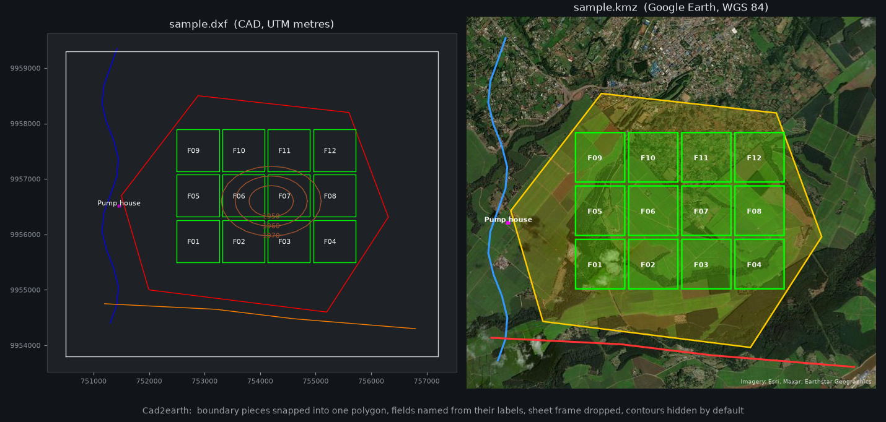

# Cad2earth

[](https://github.com/silaselisha/Cad2earth/actions/workflows/test.yml)
[](LICENSE)
[](https://docs.claude.com/en/docs/claude-code/skills)

**Convert AutoCAD DWG / DXF drawings into a KMZ that opens correctly in Google Earth.** It uses free, open-source tools and runs as a [Claude Code](https://claude.com/claude-code) skill or as standalone scripts.

Estate plans, field boundaries, irrigation layouts and survey drawings usually live in AutoCAD, in a projected coordinate system (UTM, Arc 1960…). Google Earth wants lon/lat KML. This tool:
- finds the drawing's coordinate system;
- reprojects the drawing;
- turns closed outlines into real polygons named from their labels;
- keeps each CAD layer as a folder;
- styles everything;
- checks the result fits Google Earth's import limits.



```
DWG ──LibreDWG dwg2dxf──▶ DXF ──GDAL + dxf2kmz.py──▶ KML ──zip──▶ KMZ
```

## Features

- **Finds the CRS for you:** reads the georeference embedded by Civil 3D (`UTM84-36S` → EPSG:32736), or takes `--epsg`. Includes notes on UTM zones and Arc 1960 vs WGS 84 for East Africa.
- **Real polygons:** closed polylines become polygons with area in hectares, and hatches become filled areas. Contours, pipes and roads stay lines.
- **Fixes messy drawings:** snaps boundaries drawn as separate pieces into one polygon (`--join-layers`). Removes duplicates, sheet frames, title blocks and dimensions, and repairs invalid polygons.
- **Readable in Google Earth:** folders by theme → CAD layer, colours from the drawing, and labels as names. Block inserts (valves, pumps…) become symbols, and contours are hidden by default.
- **Fits import limits:** simplifies invisibly (0.5 m) and warns above Google Earth's 250k-vertex / 10k-feature "Import as map features" limits.
- **Honest report:** prints JSON covering:
  - the source CRS and why it was chosen;
  - features per layer;
  - everything skipped or joined, and why;
  - the WGS 84 bounding box;
  - the vertex count.

## Try it in one minute

```bash
git clone https://github.com/silaselisha/Cad2earth.git && cd Cad2earth
bash scripts/qgis-python.sh scripts/dxf2kmz.py examples/sample.dxf sample.kmz --epsg 32736 --join-layers '^FARM BOUNDARY$'
```

Open `sample.kmz` in Google Earth: a made-up 1,400 ha estate near Kericho, Kenya. Or download [`examples/sample.kmz`](examples/sample.kmz) directly.

## Install as a Claude Code skill

```bash
git clone https://github.com/silaselisha/Cad2earth.git ~/.claude/skills/cad2earth
```

Then, in any Claude Code session, ask, e.g., *"convert Desktop/ESTATE BOUNDARIES.dwg to kmz"*. Claude follows [SKILL.md](SKILL.md):
1. inspect the drawing;
2. work out the CRS;
3. convert;
4. verify the location on satellite imagery;
5. report what could not be converted.

## Requirements

| | Windows | Debian / Ubuntu | macOS |
|---|---|---|---|
| GDAL + Python | [QGIS](https://qgis.org) (bundled) | `sudo apt install python3-gdal` | `brew install gdal && pip install gdal==$(gdal-config --version)` |
| DWG → DXF | `bash scripts/get-libredwg.sh tools/libredwg` (portable download) | `sudo apt install libredwg-tools` | `brew install libredwg` |
| Shell | Git Bash | bash | bash |

Only DXF input? You don't need LibreDWG.

## Usage

```bash
DWG2DXF=$(bash scripts/get-libredwg.sh tools/libredwg)       # Windows: downloads; Linux/macOS: finds it on PATH
"$DWG2DXF" -y -o in.dxf in.dwg
bash scripts/qgis-python.sh scripts/inspect_dxf.py in.dxf     # units, extents, embedded CRS, geometry per layer
bash scripts/qgis-python.sh scripts/dxf2kmz.py in.dxf "Out.kmz" --kml
```

| Option | Default | Purpose |
|---|---|---|
| `--epsg N` | from the drawing | source CRS (projected, metres) |
| `--join-layers RE` | none | layers whose open pieces form one boundary ring |
| `--snap M` | 40 | max gap (m) snapped when joining |
| `--line-layers RE` | contour, pipe, road, stream… | closed shapes on these layers stay lines |
| `--hidden-layers RE` | `0`, elevation, contours | exported but switched off |
| `--skip-layers RE` | `Defpoints` | left out |
| `--simplify M` / `--simplify-hidden M` | 0.5 / 2 | simplification in metres |
| `--far M` | 100000 | drop details drawn far from the map (e.g. at the origin) |
| `--kml` | off | also write the plain `.kml` |

## Opening the result

- **Google Earth Pro:** File → **Open** (not Import).
- **Google Earth web:** Projects → Import KML → "Import as map features". The report warns if the file is over the limits; otherwise use "Import as a data layer".
- **QGIS, ArcGIS, Google My Maps** also read KMZ.

## Limitations

- LibreDWG can't decode every entity of every DWG. Very large polylines sometimes come out empty. The skill reports them by layer and handle. The free (not open-source) ODA File Converter is the fallback.
- Drawings that aren't georeferenced (local grid, no CRS, millimetre units) need control points, which this tool doesn't do.

## Contributing

Issues and pull requests are welcome, especially:
- sample drawings with other coordinate systems;
- a pip-installable CLI;
- support for block attributes.

CI converts the sample drawing on every push (`examples/check_sample.py`).

## License

[MIT](LICENSE). LibreDWG is GPL and is downloaded separately, not bundled.
